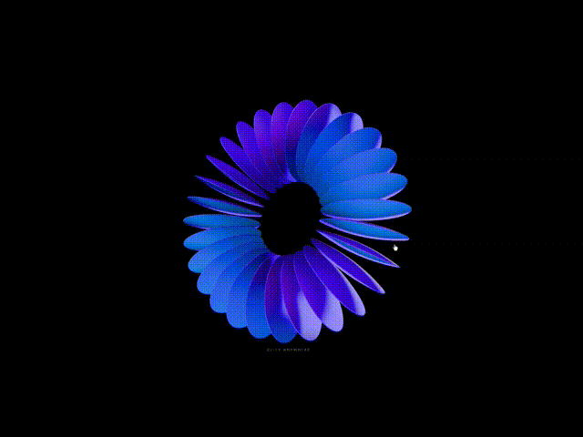
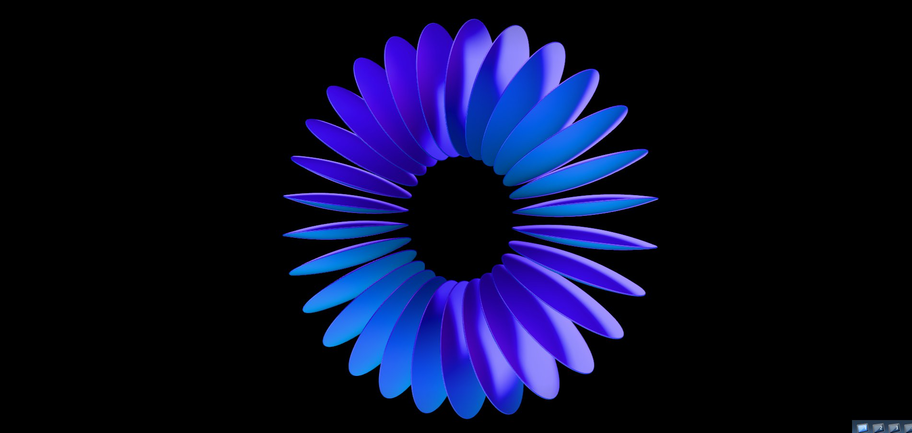
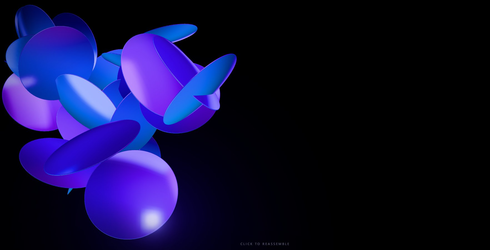
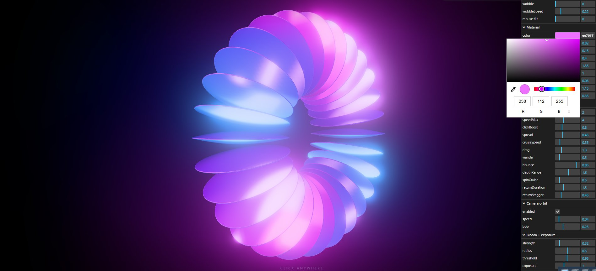

# Threejs 3D Glass Ring 
### Click | Explode | Interactive | WebGL | Animation | Physics | Post-processing | MSAA | Custom Shaders | reflections 

## Preview
<p align="center">




</p>

A ring of thin, satin iridescent glass discs turning around a shared centre, seen straight on as a sunburst, with the camera slowly orbiting around it.

**Click anywhere** and the ring explodes: every disc bursts away from where you clicked, tumbles, and floats in zero gravity, bouncing off the edges of the screen so nothing leaves the view. **Click again** and the discs fly back into their exact slots in the ring. Space or Enter does the same from the keyboard.

Built with three.js r186, bundled in `lib/`, so the page itself needs no build step and works offline. npm is only used for the local server.

## Run

```bash
npm install
npm start
```

Then open http://localhost:8080. (ES modules don't load from `file://`, so the page needs a local server; `npm start` runs one.)

Or `python -m http.server 8080` or VS Code's Live Server extension work too.

## Live tuning

Open `http://localhost:8080/?debug` for a slider panel (ring shape, twist, motion, material, explode physics, camera orbit, bloom, exposure). When you like the look, press **Copy config (JSON)** and paste the values into `js/config.js`.

## How it works

| File | What it does |
|---|---|
| `js/config.js` | Every tunable value: ring shape, twist, speeds, colours, camera, explode physics |
| `js/disc-geometry.js` | One disc built with `LatheGeometry`: a lens-shaped cross-section with a rounded rim, spun 360 degrees. Normal = local +Z |
| `js/ring.js` | `InstancedMesh` of all discs (one draw call). `homeMatrix()` gives each disc's slot: `T(position) * Rz(angle) * Rx(90deg + lean)` around the shared centre |
| `js/explode.js` | Click controller. Free discs are simulated in camera space, where the visible area at depth d is `d * tan(fov/2)` (times aspect for width), so bouncing off the screen edges is a cheap check that stays correct on resize. Reassembly eases each disc back to its live, still-turning slot |
| `js/camera-rig.js` | Fixed camera with an auto orbit that eases to a stop while the ring is exploded and resumes once it is whole |
| `js/studio-env.js` | A hidden studio (gradient dome + bright softbox panels) baked into an environment map. That's where the cyan / indigo / pink gradients and the bright rim lines come from. No image files |
| `js/main.js` | Renderer, post-processing (MSAA, bloom, Neutral tone mapping), click / key handling, animation loop |
| `js/debug.js` | The `?debug` panel (lil-gui) |

## Common tweaks (all in `js/config.js`)

- **Explosion strength:** `explode.speedMin` / `speedMax`, plus `clickBoost` for discs right under the click
- **How the discs float afterwards:** `explode.cruiseSpeed` (drift speed), `wander` (random float), `bounce` (edge bounciness), `depthRange` (toward / away from camera)
- **Reassembly feel:** `explode.returnDuration` and `returnStagger`
- **Camera angle:** `camera.position`
- **Camera orbit:** `camera.orbit` (`enabled`, `speed`, `direction`, `bob`)
- **More or fewer discs:** `ring.count`
- **Blade width:** `ring.bulge` (higher = wider blades)
- **Ring turning speed:** `motion.flowSpeed` (negative reverses it)
- **Angled spiral look instead of sunburst:** see the comment above `twist` in `config.js`
- **Performance on weak GPUs:** open with `?quality=low`, or set `render.maxPixelRatio` to 1.5 or 1

## Notes

- Discs can pass through each other in depth while floating. They never leave the screen.
- With the system "reduce motion" setting on, the ring, orbit and explosion all run slower.
